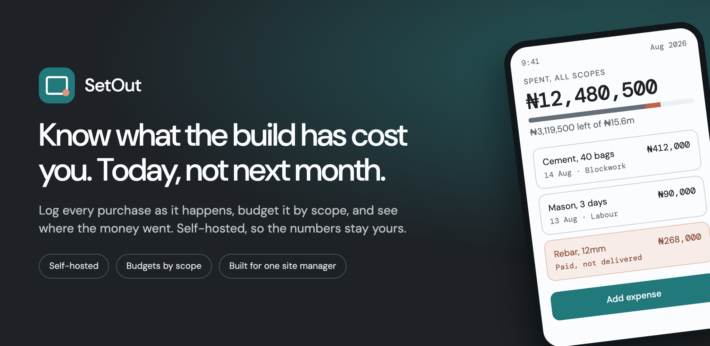

<p align="center">
  
</p>

<h1 align="center">Setout</h1>

<p align="center">Track the cost of a building project as the money is spent.</p>

<p align="center">
  <a href="https://github.com/bolorundurovj/setout/actions/workflows/ci.yml"></a>
  <a href="https://github.com/bolorundurovj/setout/releases"></a>
  <a href="https://github.com/bolorundurovj/setout/pkgs/container/setout"></a>
  <a href="https://hub.docker.com/r/bolorundurovj/setout"></a>
  <a href="LICENSE"></a>
</p>

<p align="center">
  
</p>

Setout is a self-hosted web app for tracking construction expenses on personal building projects. It replaces a spreadsheet whose budget figures were entered after the money was spent. In Setout a budget belongs to a category and is set deliberately. An expense records spending and cannot change a budget value.

- Backend: Python, FastAPI, Tortoise ORM (with its built-in migration CLI).
- Frontend: Angular, consuming a TypeScript SDK generated from the OpenAPI schema.
- Database: SQLite by default, Postgres optional.
- Deployment: one container, one port; SQLite by default, or the compose stack with Postgres and MinIO.

See the product in action in the [full showcase](docs/showcase.md).

## Quick start

With Docker:

```bash
docker compose -f docker/docker-compose.yml pull
docker compose -f docker/docker-compose.yml up -d
```

This pulls the published image, `ghcr.io/bolorundurovj/setout` for amd64 and
arm64, and starts the app on port 8474 with Postgres for the database and MinIO for attachments. The same image is published to Docker Hub as `bolorundurovj/setout`. To run from a checkout instead:

```bash
make setup    # install backend and frontend
make dev      # run the API and the web app together
```

Open the web app. On the first run it asks you to create the local admin
account with a passphrase. There are no roles and no email address is required: one passphrase, and a session cookie on your device.

Windows is supported from cmd.exe, Cmder and Git Bash, with one constraint about WSL
described in [installation](docs/installation.md).

Before putting Setout anywhere other people can reach, read
[deployment](docs/deployment.md). The defaults exist so that the stack starts with one command. They are not suitable for production.

## Recording expenses

Open a project and select **New Expense**. Only the description and amount are required, and the purchase date defaults to today. The form is designed for one-handed use on a phone.

- Enter a **Quantity** and a **Unit Rate** and the amount is calculated: 600 nine inch blocks at 250 each. If you enter only one of them, enter the amount yourself. The value you entered is still stored.
- A **Category** is optional. An expense with no category is still included in the project total, and is listed as Uncategorised so you
  can assign a category later. A missing budget never prevents saving an expense.
- A category with subcategories has no expenses of its own. Assign the expense to a subcategory.
- Amounts are stored as whole numbers in the currency's minor units, so nothing
  is lost to rounding. NGN 11,000.00 is stored as 1100000.
- The list filters by description or notes, vendor, person, item and a date range, and sorts by date or
  by amount. The filters are stored in the URL, so a filtered view is kept after a refresh and can be
  shared as a link. The list shows the total of all matching expenses.
- Archiving an expense keeps the row. **Show archived**
  on the expenses list displays archived rows with a **Restore** button.
  Archiving is the only way to remove data in Setout: nothing is permanently deleted.

An expense can also record the **Item**, the **Vendor** and who paid (**Paid By**). All three are optional.

## Items, vendors and people

These three are shared by the whole installation, not owned by a project, because the same vendor and the same item are used across projects. Their amounts are always reported per project, and amounts in different currencies are never added together.

- An **item** is something you buy more than once. It stores no prices of its
  own: each expense assigned to it with a unit rate is added to its price history, so
  the first, last, lowest and highest price and the change between them are always
  calculated from the expenses. Select an item on the expense form and it shows
  the latest unit rate, in that project's currency, and offers it as the unit rate.
- A **vendor** is a supplier you buy from. You can add one from the expense
  form with only a name, and add the trade and phone number later.
  Archiving a vendor keeps every expense assigned to them; they are no longer
  listed on the form.
- A **person** is someone who spends money on your behalf. Recording who paid
  is what makes it possible to calculate what you owe them.

## Documentation

| Guide                                            | What it covers                                      |
| ------------------------------------------------ | --------------------------------------------------- |
| [Installation](docs/installation.md)             | Docker, bare metal, the first run                   |
| [Configuration](docs/configuration.md)           | Every environment variable, app and compose         |
| [Deployment](docs/deployment.md)                 | Postgres, S3 or MinIO, HTTPS, upgrades              |
| [Backup and restore](docs/backup-and-restore.md) | The two kinds of backup, and when each applies      |
| [Troubleshooting](docs/troubleshooting.md)       | Common failures and their fixes                     |
| [Architecture](docs/architecture.md)             | Request flow, and why the SDK is generated          |
| [Development](docs/development.md)               | The Makefile, the test layers, migrations, the SDK  |
| [Roadmap](docs/roadmap.md)                       | Designed but not yet built                          |
| [Changelog](CHANGELOG.md)                        | What changed in each release                        |

## Repository layout

```
apps/api             FastAPI service (uv, pyproject.toml)
apps/web             Angular application
packages/api-client  generated TypeScript SDK
scripts              SDK generation, seed, backup, restore
docker               Dockerfile and the compose stack
docs                 documentation
```

## The Makefile

`make setup`, `make dev`, `make check`. `make check` is the required check: lint, types, the full test suite against a coverage floor, and a check that the committed SDK still matches the schema. The full list of targets is in
[development](docs/development.md), or run `make help`.

## Contributing

Issues and pull requests are welcome. [CONTRIBUTING.md](CONTRIBUTING.md) covers setup, the project rules, and the pull request checklist. The project
follows the [Contributor Covenant](CODE_OF_CONDUCT.md).

Report security issues privately, as described in
[SECURITY.md](SECURITY.md).

## Licence

[GNU Affero General Public License v3.0 or later](LICENSE). You may run, study, change and share it. If you offer a modified version over a network, you must publish your source as well.
