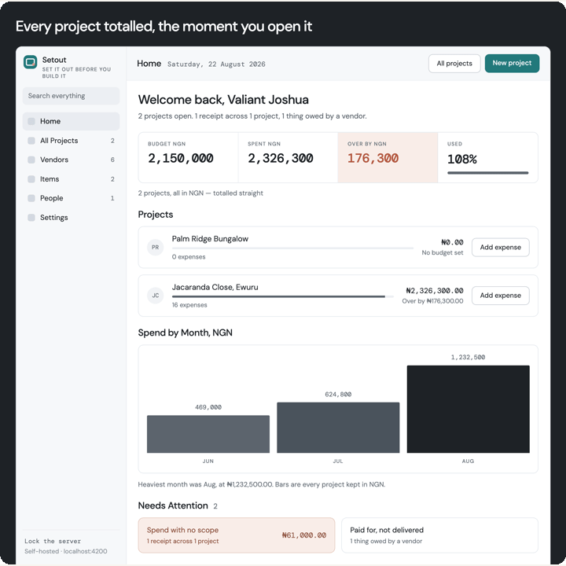
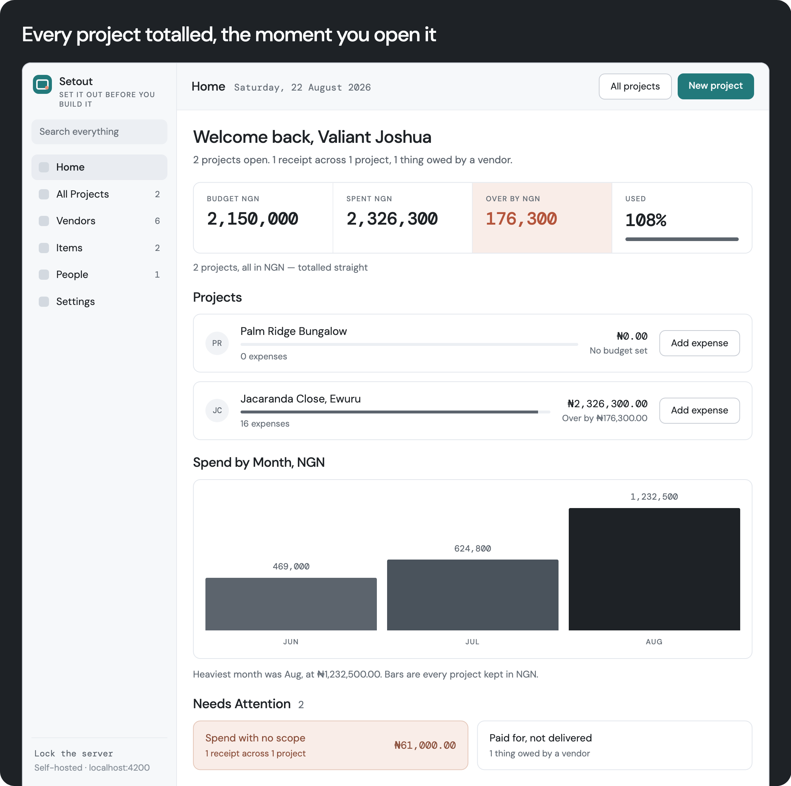
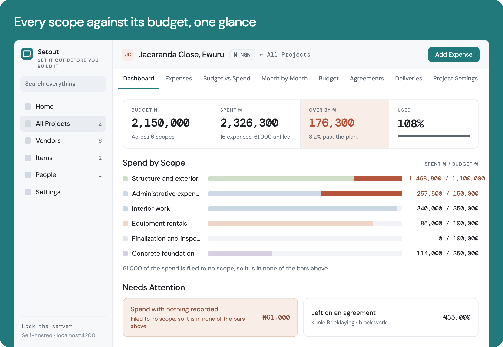
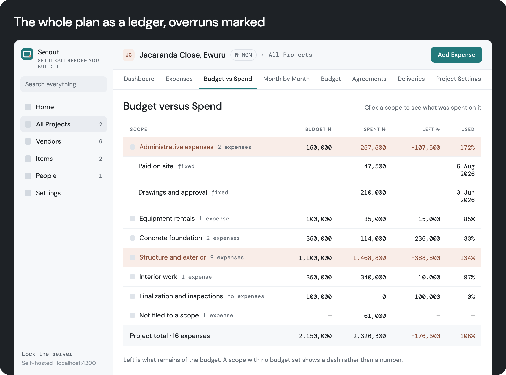
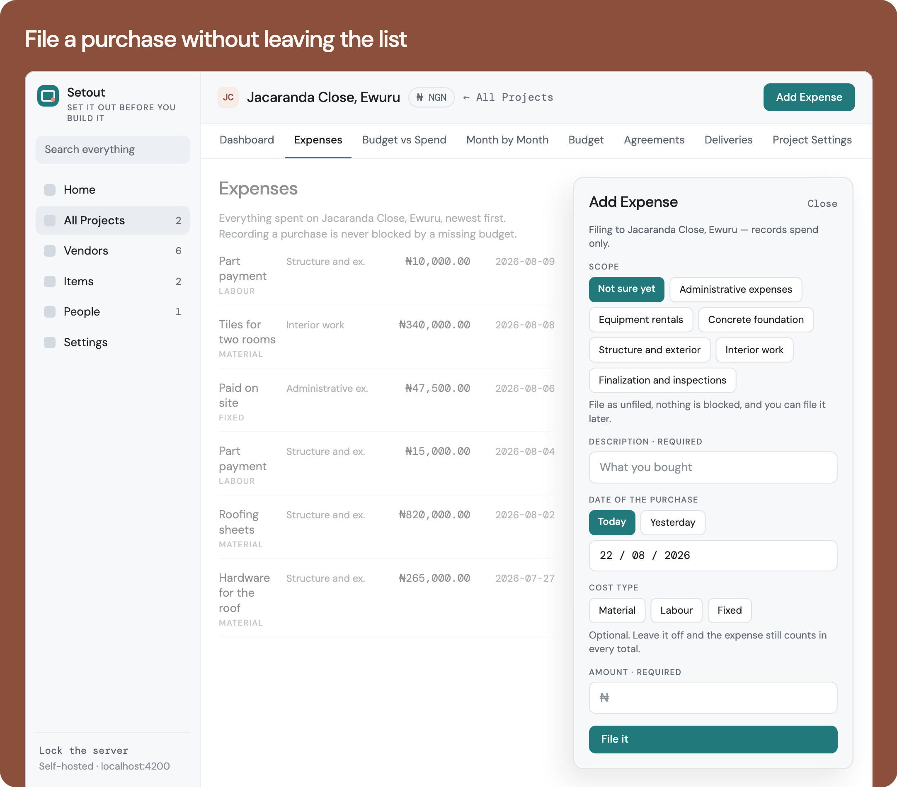

# Setout Showcase

Setout tracks construction expenses while the work is in progress: set a budget by category, record expenses as they occur, and see how the money was spent.

  

## Home

The home screen shows totals for every project without combining currencies, and lists the
alerts that need attention.

  

## Project dashboard

Each project shows its budget, expenses, monthly totals and outstanding deliveries in one place.

  

## Budget vs Spent

Categories keep budgeted costs separate from actual expenses, so the budget can be
adjusted without changing the recorded expenses.

  

## New expense

The form has few required fields, so it can be completed on a phone. Quantity, unit rate, category, item, vendor and who paid (Paid By) are optional.

  

